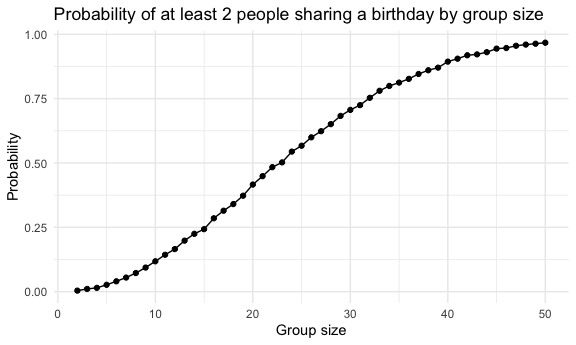
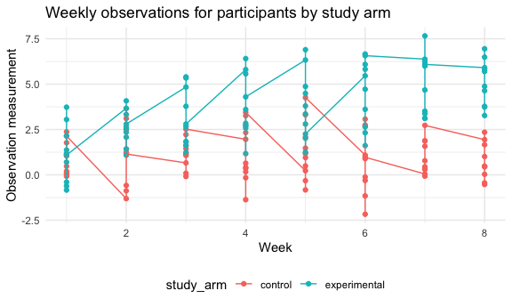

p8105_hw5_cc5423
================
Christina Chen
2026-11-17

``` r
library(tidyverse)
library(rvest)

knitr::opts_chunk$set(
  fig.width = 6,
  fig.asp = .6,
  out.width = "90%"
)

theme_set(theme_minimal() + theme(legend.position = "bottom"))

set.seed(45)
```

# Problem 1

Making a `duplicate_bday` function to generate random birthdays in
groups of `n` size and check to see if there are any duplicates:

``` r
duplicate_bday = function(n) {
  
  birthdays = sample(1:365, size = n, replace = TRUE)
  
  repeated_birthdays = length(unique(birthdays)) < n
  
  return(repeated_birthdays)
  
}
```

We can test this function:

``` r
duplicate_bday(2)
```

    ## [1] FALSE

It looks like in this specific randomly generated group of size `n` = 2,
there are no duplicates.

Making a dataframe running the `duplicate_birthday` function 10000 times
each with groups from size `n`= 2 to 50:

``` r
bday_df =
  expand_grid(
    number_of_people = 2:50,
    iter = 1:10000
  ) |> 
  mutate(
    repeated = map_lgl(number_of_people, duplicate_bday)
  )
```

We have generated a dataframe `bday_df` with 3 columns and 490000
observations. We have a column for the group size (`number_of_people`),
the iteration (which should be from 1 to 10000), and TRUE/FALSE for
duplicates in the column `repeated`. 490000 observations makes sense, as
10000 iterations for each group of size 2 to 50 would be 10000\*49,
which is 490000.

Compute the probability that at least two people in the group will share
a birthday by averaging across the 10000 simulation runs, then plot:

``` r
bday_df |> 
  group_by(number_of_people) |> 
  summarize(prob_of_repeat = mean(repeated)) |> 
  ggplot(aes(x = number_of_people, y = prob_of_repeat)) + 
  geom_point() + 
  geom_line() +
  labs(
    title = "Probability of at least 2 people sharing a birthday by group size",
    x = "Group size",
    y = "Probability"
  )
```



We can see that smaller group sizes have a lower probability of having
duplicate birthdays, but as the group size increases, the probability
that at least two people in the group will share a birthday increases.

# Problem 2

Reading in file names:

``` r
study_df =
  tibble(
    file_name = list.files(path = "data/")
  )
```

We now have a dataframe `study_df` that read in the file names in the
data folder of our project and put them in a column called `file_name`.

``` r
study_df =
  study_df |> 
    mutate(
        file_path = file.path("data", file_name),
        data = map(file_path, ~read_csv(.x)),
        file_name = str_remove(file_name, ".csv")) |> 
    unnest(data) |> 
    pivot_longer(week_1:week_8, 
                 names_to = "week", 
                 names_prefix = "week_",
                 values_to = "measurement"
                 ) |> 
    select(-file_path) |> 
    separate(file_name, into = c("study_arm", "id"), sep = "_") |> 
    mutate(
      study_arm = recode_values(study_arm, 
                          "con" ~ "control",
                          "exp" ~ "experimental"),
      id = as.numeric(id),
      week = as.numeric(week)
    )
```

I did the following processes:

- Read in all the data using `map()` iteration
- Remove the “.csv” portion of the file_name
- Unnest the data
- Made the data long format so it is tidied
- Remove column `file_path` since that is no longer needed
- Separate `file_name` into the arm type (control versus experimental)
  and the id number
- Rename the `arm` values to be the full word
- Make `id` and `week` numeric

Make a spaghetti plot showing observations on each subject over time:

``` r
study_df |>
  ggplot(aes(x = week, y = measurement, color = study_arm)) + 
  geom_point() +
  geom_line() +
  labs(
    title = "Weekly observations for participants by study arm",
    x = "Week",
    y = "Observation measurement"
  )
```


Experimental arm participants start off very similar to control arm
participants in observations. Over time, the gap between the two widen.
Experimental arm participants had overall higher measurements than the
control arm participants. These measurements seem to generally increase
over time.
